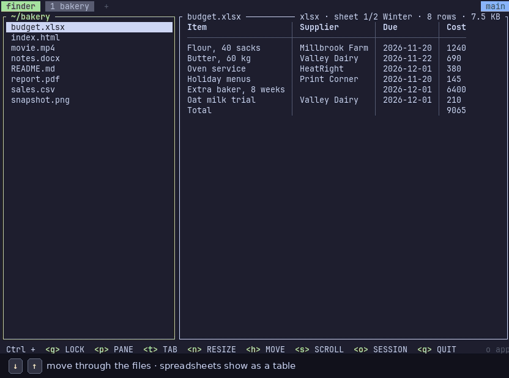

# termos: a terminal OS

[](https://github.com/hugegene/termos/releases/latest)
[](LICENSE)


**Drop all desktop apps, use `tos`.**

termos (`tos`), short for terminal OS, is a terminal workspace with a terminal file finder built in. It does the
jobs of your file manager, your file viewers and tmux: browse, preview and edit files, keep sessions alive through
reboots, and run AI coding agents side by side, all in one program.



```bash
curl -fsSL https://github.com/hugegene/termos/releases/latest/download/install.sh | sh
tos                  # start a session, or go back to the one running
                     # then Ctrl+t, f opens the finder on the folder you're in
```

<details>
<summary><b>Watch the full tour</b> (90 seconds, with every key shown)</summary>


</details>

## Instead of…

| Instead of | In `tos` |
|---|---|
| Finder, Files or Explorer | `tos finder`: browse, filter, rename, copy a path, move to the trash, `o` opens in its app |
| A PDF reader | a PDF's text, or its pages as images, with zoom |
| An image viewer | real images in Ghostty, kitty, WezTerm, iTerm2 and xterm (with sixel) |
| A video player, for a look | its length, size and a frame; `o` plays it |
| A text editor, for quick edits | Neovim inside the preview: `Ctrl+s` saves, `Ctrl+e` closes |
| Excel or Numbers, for a quick look | spreadsheets as tables, and CSV edited in a grid |
| Word or PowerPoint, for reading | documents and slides shown as Markdown |
| tmux or zellij | tabs, splits and sessions that come back after a reboot, with zellij's keys and tmux's |

Some jobs still need the app: `tos` can't save spreadsheets or Word files, and `o` opens them there.

## Why termos?

termos began as zellij, yazi and a preview script glued together. It's now one program with one set of keys
(zellij's): the multiplexer and the finder share a session, so your tabs, splits and the finder's folder come
back after a reboot. Everything is scriptable through one command line, so extensions are plain programs in any
language.

## AI agents side by side

Run Claude Code, Codex or any other agent in a tab, and keep the finder open next to it. The files it writes
appear in the finder straight away, previewed and ready to edit. Sessions keep running when you close the
window, so an agent can work while you're away, and `tos` takes you back to it.

[prbot](https://github.com/hugegene/prbot) goes further: it opens a Claude tab for each GitHub PR that needs
you (see [Extending](#extending)).

## Install

```bash
curl -fsSL https://github.com/hugegene/termos/releases/latest/download/install.sh | sh
```

It installs `tos` for you alone, without sudo, on Linux (x86_64 or arm64) and on Macs with Apple Silicon.
Upgrade with `tos update`.

<details>
<summary><b>Details:</b> where it runs, what it changes, upgrading, optional programs</summary>

- **Where it runs:** Linux on x86_64 or arm64 with glibc 2.34 or newer (Ubuntu 22.04+, Debian 12+, RHEL 9+),
  and Macs with Apple Silicon.
- **Where it goes:** `~/.local/bin/tos`, without sudo. `TOS_INSTALL_DIR=<folder>` picks another folder, and
  `TOS_VERSION=0.2.0` a particular version. Run it again to upgrade.
- **PATH:** if that folder isn't on your `PATH`, it adds it to your shell's startup file, once. That's
  `~/.zshrc`, `~/.bashrc` (`~/.bash_profile` on macOS), fish's `conf.d/termos.fish`, else `~/.profile`.
  `TOS_NO_MODIFY_PATH=1` skips this and prints the line instead.
- **What it checks:** the download's SHA-256, and that `tos` runs, before it replaces anything.
- **Upgrading:** `tos update`. Each version lives in `~/.local/share/termos/versions/`, `~/.local/bin/tos`
  links to the current one, and the one before is kept. Sessions show a note in the status bar when a newer
  release is out (at most one check a day; `TOS_NO_UPDATE_CHECK=1` turns it off).
- **Optional programs:** Neovim (editing text; without it, nano), poppler (PDF), ffmpeg (video previews), mpv
  (playing videos) and gio or trash.
  `tos` names the package when one is missing.

</details>

## Sessions

```
 your terminal window              background (keeps running)
┌───────────────────┐  1 keys    ┌───────────────────────────────┐
│ tos (client)      │──────────▶ │ tos server, session "main"     │
│                   │ ◀──────────│  tab 1: shell │ shell          │
└───────────────────┘  2 screen  │  tab 2: finder                 │
                                 └───────────────────────────────┘
 close the window or detach: the server keeps your shells running; `tos` reconnects
```

Session commands are **zellij's**, with the same names, aliases and flags:

```bash
tos attach work           # or: tos a work, tos -s work; starts "work" if needed (-c is accepted)
tos attach -b work        # start it in the background without attaching
tos attach --forget work  # forget its saved layout and start fresh
tos attach -f work        # when restoring, run the commands that were running
tos list-sessions         # or: tos ls; -s names only, -r reversed
tos kill-session work     # or: tos k work; keeps the layout for next time
tos delete-session work   # or: tos d work; forgets the saved layout (-f also ends a running session)
tos kill-all-sessions     # or: tos ka; -y skips the question
tos delete-all-sessions   # or: tos da; -y skips the question, -f also ends and forgets running ones
```

Unlike zellij, plain `tos` returns to "main" instead of starting a new session with a random name.

**Sessions come back.** `tos kill`, Ctrl+q, a crash or a reboot keeps the session's layout: tabs, splits, names,
folders and finder state. Attaching again restores it. A command that was running is typed at the prompt
without Enter. `tos ls` shows saved sessions, and `tos delete NAME` forgets one.

## Keys and mouse

Inside a session the keys are **zellij's** (your `~/.config/zellij/config.kdl` bindings), and each pane has a
frame like zellij's:

| Keys | Mode and what it does |
|---|---|
| `Ctrl+p` | **pane:** arrows/`hjkl` focus, `n` new, `d` down, `r` right, `x` close, `f` fullscreen, `z` frames, `c` rename |
| `Ctrl+t` | **tab:** arrows switch, `n` new, `x` close, `r` rename, `1`–`9`, `Tab` last, `s` sync, `b` break out, `f` finder |
| `Ctrl+n` | **resize:** arrows/`hjkl` grow that side, `HJKL` shrink it, `+` `-` |
| `Ctrl+h` | **move:** arrows/`hjkl` swap the pane with its neighbour, `n` `p` |
| `Ctrl+s` | **scroll:** `↓↑` `d` `u` `PgDn` `PgUp`, `s` search (`n` `p` `c` `w` `o`), `e` edit in the editor, `v` select with vi keys. In an editor tos started, `Ctrl+s` saves instead |
| `Ctrl+o` | **session:** `d` detach |
| `Ctrl+b` | **tmux keys:** `c` `%` `"` `,` `[` `o` `n` `p` `z` `x` `d`, plus `f` finder |
| `Ctrl+g` | **lock:** all keys go to the program until `Ctrl+g` again |
| `Ctrl+q` | quit: ends the session (asks first) |
| `Alt+n`, `Alt+arrows`, `Alt+=`/`Alt+-`, `Alt+i`/`Alt+o` | new pane, focus, resize, move the tab |

`Esc` or `Enter` leaves a mode; `?` in any mode shows all keys. Not in `tos` yet: floating, stacked and pinned
panes, swap layouts, pane groups and zellij's plugins.

- **Mouse:** click to focus, click tabs, drag the lines between panes to resize, wheel to scroll back, drag to
  select and copy (OSC 52).

## Terminal file finder

- **Moving:** the arrows move; `←` and `→` move focus between the file list and the preview, and up and into
  folders. `Enter` in the list does what `→` does. `[` `]` page through a preview. `/` filters, `.` hides hidden
  files (shown by default).
- **Editing:** `Enter` in the preview edits in tos: Neovim for text, the grid for CSV and spreadsheets. In both,
  `Ctrl+s` saves and `Ctrl+e` closes, the same on Mac and Linux (`Alt+s` and `Alt+q` work too, but on a Mac they
  need the terminal's Option-as-Alt setting). Where tos can't edit a file, the caption doesn't offer `Enter`.
- **Without Neovim:** `Enter` opens nano instead (`Ctrl+s` saves, `Ctrl+x` closes), or without nano your
  `$VISUAL` or `$EDITOR`, else `vi` (`Esc` `:wq`), each with its own keys. tos says once how to install Neovim.
  `TOS_EDITOR` picks any editor.
- **Opening in an app:** `o` opens any file or folder in its default app (`xdg-open`, or `open` on macOS), on the
  screen of the terminal you pressed it in.
- **The menu:** right-click a file, or press `m`, to rename it, copy its name or path, open it in its app, or
  delete it (to the trash; where there's no trash it asks first).

**Images** show for real in terminals that support kitty, iTerm2 or sixel images (Ghostty, kitty,
WezTerm, iTerm2, xterm with sixel), and as coloured blocks elsewhere. Force one with
`TOS_IMAGES=kitty|iterm2|sixel|blocks`. Enter in a `.csv`/`.tsv` preview opens a **grid editor**: arrows move,
`e` edits a cell, `a`/`A` add a row or column, `d`/`D` delete one, `u` undoes, `Ctrl+s` saves and `q` or `Ctrl+e` closes.
`v` (or `V` for whole rows, or a mouse drag) selects a range of cells, and `y` copies it as tab-separated text,
which spreadsheet apps paste as cells. `E` opens any text file in Neovim.

**PDFs** in the finder show their text; `t` shows each page as an image (`+`/`-` zoom, `0` fit width), and `t`
again goes back to the text. `[` `]` page in both. This needs poppler (`sudo apt install poppler-utils`, or
`brew install poppler` on macOS).

**Videos** show their length, size and a frame from 10% of the way in, which needs ffmpeg
(`sudo apt install ffmpeg`, or `brew install ffmpeg`). `o` plays one in your default video player, as it opens
any file; with no default set, in mpv (`sudo apt install mpv`), or else ffplay. Attached over SSH without X
forwarding, there's nowhere to show it.

**Spreadsheets** (`.xlsx`, `.xlsm`, `.xlsb`, `.xls`, `.ods`) show their first sheet as a table, with formulas'
last values and dates as `2026-11-07`; `[` `]` in the preview change sheet. `Enter` in the preview opens the
sheet in the grid, **read-only** (`tos` can't save these formats), where you can select and copy cells.
**Word** (`.docx`) and **PowerPoint** (`.pptx`) files show as Markdown: headings, lists, tables, bold and italic,
and a section per slide. Old `.doc` and `.ppt` files aren't read.

**Links** in a Markdown preview can be clicked: the finder shows the linked file, and `Backspace` goes back.

## Extending

**Extending `tos`** works through the same command line, from any language; there are no plugins. See
[docs/cli.md](docs/cli.md) for the overview and [docs/cli/](docs/cli/README.md) for a page per command.

**Example: prbot** ([github.com/hugegene/prbot](https://github.com/hugegene/prbot)) is a full-size extension. It
opens a Claude tab for each GitHub PR that needs you:

[](https://github.com/hugegene/prbot)

```bash
tos action new-pane -d right -- make test    # zellij's actions, names and flags; prints terminal_7
tos action list-tabs -j                      # JSON with zellij's fields
tos subscribe -f json                        # events: tabs and panes opening, closing, exiting, …
tos action set-status --id ci "build ✓"      # text in the status bar; clicks arrive as events
tos run -- htop                              # also: tos edit FILE, tos watch NAME
```

Keys can run commands. Add zellij-style `bind` blocks to `~/.config/termos/config.kdl`, for example
`tab { bind "p" { Run "prbot" "ls"; SwitchToMode "Normal"; } }`. A zellij script such as `prbot` ports by
changing `zellij` to `tos` and `ZELLIJ_*` to `TOS_*`.

## Development

- **Build:** `cargo build --release` gives `target/release/tos`. `CLAUDE.md` lists the tests and checks.
- **Demo:** `python3 scripts/demo/record.py` records the GIFs above again, on a virtual display: the short
  `docs/images/demo-short.gif`, the full tour `finder-demo.gif`, and `finder-demo.webp`. `--video` and `--image`
  choose what the video and picture steps show. The Claude part needs Claude Code signed in; `--no-claude` leaves
  it out. See `docs/plans/2026-11-13-finder-demo-gif.md` for what else it needs.
- **Release:** set `version` in `Cargo.toml`, commit, then push a tag `v<version>`.
  `.github/workflows/release.yml` builds each target with `scripts/package.sh` and publishes the release
  with `scripts/install.sh`. See `docs/plans/2026-11-09-distribution.md`.

## License

MIT, see [LICENSE](LICENSE). `crates/alacritty_terminal` is a fork of Alacritty's terminal crate and stays
under its own license, Apache-2.0 ([crates/alacritty_terminal/LICENSE-APACHE](crates/alacritty_terminal/LICENSE-APACHE)).
